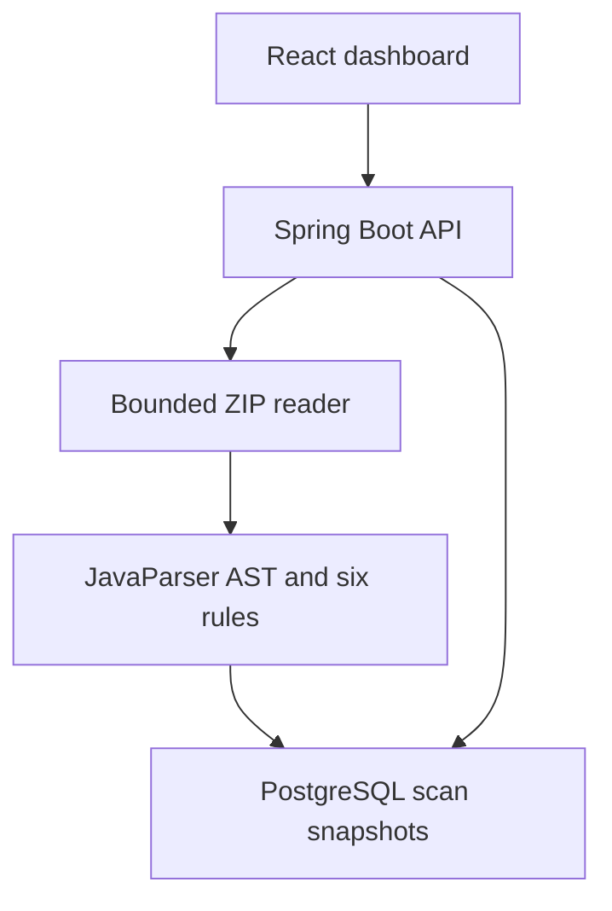

# Java Code Quality Analyzer

A Java 21 static-analysis application with a React dashboard. Upload Java source as a ZIP, inspect maintainability findings against six documented rules, browse the source snapshot, compare finding counts across scans, and export reports.

Source is parsed into a JavaParser abstract syntax tree (AST). It is never compiled or executed. This project focuses on explainable Java maintainability heuristics rather than reproducing SonarQube's feature set.

## Dashboard Preview


## Start the application

Requires Docker Desktop or Docker Engine with Compose, plus Python 3 for automatic port selection. From this directory:

```bash
bash start.sh
```

On first launch, the script selects available host ports and writes them to `.env`. It preserves an existing `.env` on later launches. Default candidates are:

| Service | Default address |
|---|---|
| Dashboard | http://localhost:33479 |
| API | http://localhost:38479/api/scans |
| Health | http://localhost:38479/actuator/health |
| PostgreSQL | localhost:35479 |

If one of those ports is occupied, the first-launch script selects another available port and prints the actual dashboard address. Port selection is a best-effort check before Docker binds; the final Docker bind is authoritative. Environment variables exported in your shell override `.env` under normal Compose rules.

The first build downloads dependencies, runs backend tests and builds the frontend. The dashboard may show a temporary connection error while Spring Boot starts; reload once the backend is ready.

Without the helper, copy `.env.example` to `.env`, adjust ports if necessary, and run:

```bash
docker compose up --build -d
```

Useful commands:

```bash
docker compose logs -f backend
docker compose down
```

Job Scheduler can remain running: this project uses a separate Compose network, database volume and default port range. **`docker compose down -v` deletes this analyzer's stored scans and source snapshots.**

## First scan

1. Open the dashboard and click **Try sample project**.
2. The backend analyses the bundled source ZIP using the real rule engine.
3. Expect **2 Java files**, **3 methods/constructors**, **6 findings**, and a maximum method complexity of **18**.
4. Select **Inspect** on a finding to see its source line, measured value, rule definition and refactoring consideration.
5. Try severity/rule filters and findings search.
6. Open **Files** to browse source and parse diagnostics; open **Rules** to inspect the thresholds.
7. Upload `samples/demo-project.zip` again using the same project name, `Demo commerce project`. The dashboard will show the difference in finding count against the previous scan with that name.
8. Open **Scan history**, select a saved scan, or export CSV/JSON.

The deliberately imperfect sample sources are in `samples/demo-project/`; you can refactor them, create another ZIP and compare the results. The bundled ZIP and the dashboard sample are identical.

## Scan your own project

Use **New scan**, give the project a stable name, and select a ZIP containing `.java` files. For example, from a Java project's root:

```bash
zip -r source.zip src
```

For a multi-module project, include the modules' source directories instead. Avoid bundling dependencies or build output. Use the same project name for related scans. The displayed count delta is a comparison of uploaded snapshots, not proof of improvement; file selection, parsing coverage and source contents affect it.

Source files must be UTF-8 and use Java syntax supported by the configured Java 21 parser. Missing dependencies are fine because this version performs syntax parsing without symbol resolution.

### Input limits

| Limit | Value |
|---|---|
| Compressed upload | 20 MiB |
| All expanded entry data, including ignored entries | 10 MiB |
| ZIP entries | 2000 |
| Java source files | 200 |
| Each Java source file | 128 KiB |
| Methods/explicit constructors | 10000 |
| Findings returned per report | 2000 |

`.git`, `.idea`, `.gradle`, `target`, `build`, `out`, `dist`, `node_modules` and `__MACOSX` directories are excluded from analysis. Their entries still count towards archive limits. Unsafe paths and normalized duplicate entries are rejected. ZIP entries are read as data, never extracted into the filesystem.

One scan runs at a time per backend instance. A simultaneous submission receives HTTP 429 rather than an unbounded queue. Scans run synchronously; the UI shows a busy state until the report is returned.

## Implemented rules

Thresholds are fixed in the versioned `Rules.java` catalog and displayed read-only in the dashboard. Findings indicate a review opportunity, not a confirmed defect.

| Rule | Severity | Trigger |
|---|---|---|
| Excessive method complexity | High | Simplified cyclomatic complexity > 10 |
| Deep nesting | High | Syntactic control nesting > 3 |
| Long method | Medium | Physical declaration span > 50 lines |
| Large class or type | Medium | Physical type span > 300 lines |
| Too many parameters | Medium | Explicit parameter count > 5 |
| Empty catch block | Low | Catch body has no statements |

### Metric definitions

- A callable with a body starts at complexity 1; abstract/interface methods without bodies start at 0. Add one for each `if`, `for`, enhanced `for`, `while`, `do`, `catch`, ternary expression, non-default switch entry, `&&` and `||`. Multiple labels in one switch entry count once. Default entries do not add a decision.
- Nested callable declarations, nested type bodies and lambda bodies are excluded from an enclosing callable's complexity/nesting. Methods in nested types are analysed separately. Lambdas are not standalone metrics in this version.
- Nesting counts syntactic levels of `if`, loops, switch statements/expressions and ternary expressions. An `else if` is another syntactic level. This intentionally simple metric differs from other tools' definitions.
- Length is the declaration's physical line span, including comments and blank lines. A type's span includes its nested declarations. This can flag documentation-heavy code; review findings in context.
- Methods, explicit constructors and record compact constructors are counted. A compact constructor has zero explicitly declared parameters in the source. Implicit/compiler-generated methods and constructors are not counted.
- A catch with only a comment is still empty. Ignoring an exception can be intentional; the tool does not decide business intent.

## Partial results and limitations

Files with syntax, encoding or parser nesting failures appear in **Files** with diagnostics; their analysis metrics/findings are excluded. The scan is marked **PARTIAL**, not clean. The same status is used when findings are capped. The cap retains the first findings in deterministic source-path/analysis order before severity sorting; it is not a guarantee that every high-severity finding was retained.

This version does not perform type/symbol resolution, compilation, data-flow analysis, bug verification, security analysis, dependency auditing, duplication detection or test-coverage collection. It cannot establish that source is correct, secure or ready for production. A COMPLETED scan means all included files were parsed and the finding cap was not reached.

## Architecture



- `ZipSources`: bounded, in-memory ZIP reading and path validation.
- `JavaAnalyzer`: AST traversal, explicit metric definitions, findings and partial-result reporting.
- `Rules`: versioned metadata shared by reports and the Rules screen.
- `ScanStore`: parameterized JDBC persistence of scan summaries and complete JSON snapshots, created through Flyway.
- `ScanController`: upload, history, inspection and export endpoints.
- React: dashboard, findings filters, source inspection, file diagnostics, latest-100 scan history and same-name comparison.

Completed and partial reports are saved atomically in one insert. Rejected uploads are not saved. The database retains uploaded Java source text as part of each report; JSON exports include that source snapshot. CSV exports contain findings only. There is no automatic retention or deletion UI in V1. The application is intended for trusted local development, has no authentication and binds exposed Docker ports to loopback.

## Local development

Requires Java 21, Maven 3.9+, Node 22.12+ and PostgreSQL. Start the database:

```bash
docker compose up -d db
```

In a backend terminal:

```bash
cd backend
mvn spring-boot:run
```

In another terminal from the project root:

```bash
cd frontend
npm ci
npm run dev
```

Open http://localhost:5173. Vite proxies `/api` to localhost:8080. The default backend datasource uses localhost:35479. If the startup script selected a different database host port, supply its actual value via `DB_URL`, for example `jdbc:postgresql://localhost:35480/analyzer`. Database/user: `analyzer`; development password: `analyzer_dev`. `DB_USER` and `DB_PASSWORD` are also configurable.

## API

| Method | Path | Purpose |
|---|---|---|
| POST | `/api/scans` | Multipart upload: `projectName`, `file`; returns the saved report |
| GET | `/api/scans` | Latest 100 scan summaries |
| GET | `/api/scans/{id}` | Complete scan/source snapshot |
| GET | `/api/scans/{id}/findings.csv` | CSV findings export |
| GET | `/api/scans/{id}/report.json` | JSON report including source |
| GET | `/api/rules` | Six rule definitions |

```bash
curl -i -X POST http://localhost:38479/api/scans \
  -F 'projectName=Demo commerce project' \
  -F 'file=@samples/demo-project.zip'
```

Use the actual API port from `.env` if automatic selection chose another value.

## Verification and CI

```bash
mvn -B -f backend/pom.xml verify
npm ci --prefix frontend
npm run build --prefix frontend
```

JUnit tests cover Java 21 records, complexity calculations, nested scope isolation, thresholds, source locations, six-rule detection, parse/encoding failures, report caps, ZIP bounds/traversal/duplicates, persisted scan API behaviour and exports. API integration tests use H2 in PostgreSQL mode; Docker/PostgreSQL needs a separate local smoke test. GitHub Actions runs backend verification and frontend production builds on pushes and pull requests.

## Possible future enhancements

Configurable rule profiles, additional Java metrics, persistent scan queues, richer snapshot comparisons, PostgreSQL Testcontainers tests and a command-line scanner. These are optional extensions, not requirements for the current upload-to-report workflow.
